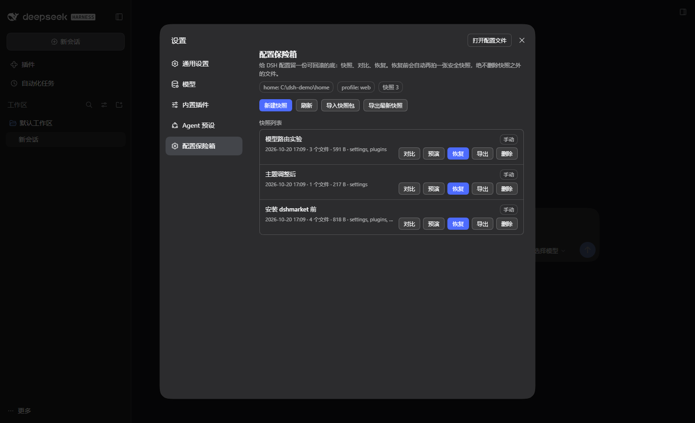
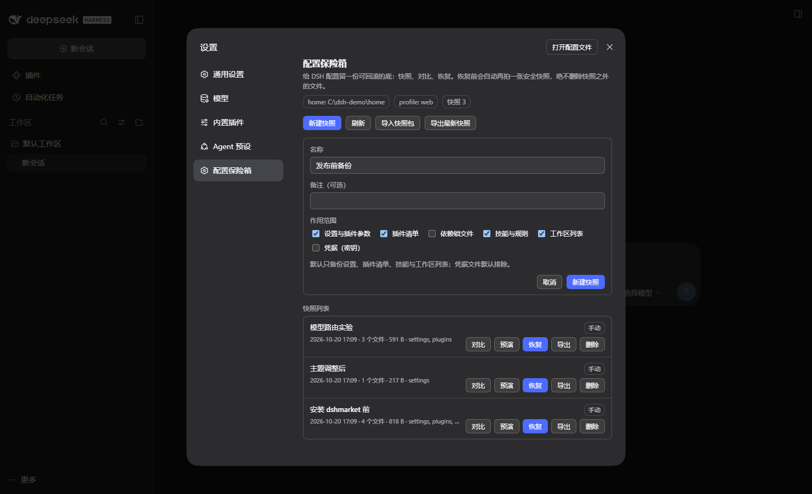
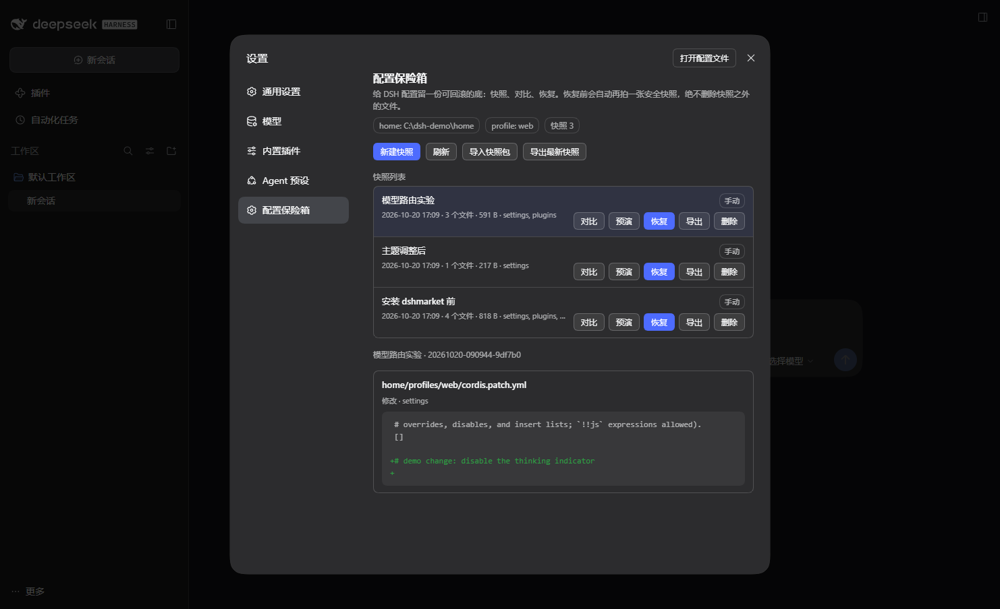

# 配置保险箱（dsh-config-vault）

[](https://github.com/klT45/dsh-config-vault/actions/workflows/test.yml)
[](https://github.com/klT45/dsh-config-vault/releases)
[](LICENSE)

[English](#english) · 中文

给 DeepSeek Harness（DSH）的配置留一份**可对比、可回滚、可带走**的底。

DSH 的配置散落在很多地方：每个 profile 的 `cordis.patch.yml`（模型路由、主题、插件参数、MCP 服务器、智能体预设都在这些行里）、`package.json`（插件清单与 bundle 顺序）、`~/.agents` 下的技能与规则、`storages/workspace.json`（工作区列表），以及 `.credentials.yaml`（登录凭据）。手动改配置出问题时，用户只能在目录里堆 `.bak-*` 文件——本插件把这件事做成产品：

- **快照**：按作用域把配置收进 `$DSH_HOME/config-vault/snapshots/<id>/`，带每个文件的 sha256；
- **对比**：快照 vs 当前磁盘、快照 vs 快照，行级 diff + JSON 变更路径，密钥值一律打码；
- **回滚**：先预演（新增/覆盖/未变/仅当前存在），再执行；执行前**自动创建安全快照**，恢复过程中任何失败都可回退；
- **不误删**：快照里没有的当前文件只会被报告，永远不会被删除；
- **凭据安全**：`.credentials.yaml` 默认不备份；一旦包含，导出**强制口令加密**（AES-256-GCM + scrypt）；
- **可带走**：导出标准 JSON 包，换机/团队共享后导入即可恢复；
- **三种入口**：设置页 UI、对话里的 `config_vault` 工具、独立 CLI，行动作完全一致。

零构建、零运行时依赖：纯 ESM JavaScript 包，`link:`/GitHub 源码安装后即可用。

## 界面

设置 → 配置保险箱（浅色/深色主题跟随宿主）：



新建快照：按作用域勾选；凭据默认排除，只有勾选「凭据（密钥）」后才会出现「包含凭据文件」的显式开关：



与当前磁盘的差异：行级 diff、按文件分组、密钥值打码：



## 安装

前置：DSH `>= 0.2.1-rc.2`。

```powershell
# 从 npm 安装（已发布，推荐）
dsh plugin --profile desktop add dsh-config-vault

# 从 GitHub 源码安装（无需 npm 包、无需构建）
dsh plugin --profile desktop add github:klT45/dsh-config-vault

# 或者本地开发时用 link:
dsh plugin --profile desktop add link:C:\path\to\dsh-config-vault
```

装完重启 DSH（或在 设置 → 插件 里启用后按提示重载），然后打开 **设置 → 配置保险箱**。

卸载：

```powershell
dsh plugin --profile desktop remove dsh-config-vault
```

> `desktop` profile 归 Desktop 壳的插件管理器管，GUI 运行中 CLI 可能不改它；此时从
> **设置 → 插件** 里安装/卸载。想先隔离验证、不碰正在用的 profile：设 `$env:DSH_HOME` 到一个空目录，
> `dsh plugin --profile vault add github:klT45/dsh-config-vault`，再 `dsh --profile vault --no-open --port 0` 启动。

## 三种用法

### 1. 设置页

侧栏 设置 → **配置保险箱**：新建快照（可勾选作用域）、查看快照列表、对比当前、恢复预演、恢复、导出/导入、删除。恢复走二次确认；含凭据的导出会就地要口令。

### 2. 对话工具 `config_vault`

模型可直接调用，`action` 取 `status / list / snapshot / diff / plan / restore / remove / export / import / prune`。典型对话：

- “给现在的配置拍个快照，叫装插件前” → `snapshot`
- “我刚才改的设置和哪个快照不一样？” → `diff`
- “回滚到装插件前那个快照” → `plan` → 用户确认 → `restore`

工具导出会写到 `$DSH_HOME/config-vault/exports/`（或指定 `file`），避免把大 JSON 塞进上下文。

### 3. CLI

```powershell
node src/cli.js status
node src/cli.js scopes
node src/cli.js snapshot --name "装插件前"
node src/cli.js diff <id>
node src/cli.js restore <id>            # 只预演
node src/cli.js restore <id> --apply    # 执行（自动安全快照）
node src/cli.js export <id> --out backup.json [--passphrase ...]
node src/cli.js import --file backup.json [--passphrase ...]
```

全局参数：`--home <DSH_HOME>`、`--agents-home <目录>`、`--profile <名称>`、`--json`。

## 作用域

| id | 内容 | 默认 | 恢复生效 |
|---|---|---|---|
| `settings` | `$DSH_HOME/cordis.patch.yml`、`profiles/*/cordis.patch.yml`、`settings.yaml` | ✅ | 重载 |
| `plugins` | `profiles/*/package.json`、`pnpm-workspace.yaml`、`compatibility.json`、`patches/**`、`plugins/*/config.*` | ✅ | 重载 |
| `deps` | `profiles/*/pnpm-lock.yaml`（精确复现插件版本，体积大） | ❌ | 重启 |
| `skills` | `$DSH_HOME/skills/**`、`~/.agents/skills/**`、`AGENTS.md`、`CLAUDE.md`（跳过 venv/node_modules/权重） | ✅ | 重启 |
| `workspaces` | `storages/workspace.json`（只存列表） | ✅ | 重启 |
| `credentials` | `.credentials.yaml`（敏感；导出必须加密） | ❌ | 重启 |

MCP 服务器与智能体预设在当前 DSH 版本里就是 `cordis.patch.yml` 的行，因此由 `settings` 覆盖，不是单独的配置文件。

## 安全模型

- **路径穿越防护**：快照内所有路径都是逻辑路径（`home/...`、`agents/...`），恢复时经 `safeJoin` 校验，只能落在已配置的根目录内；
- **回环信任围栏**：路由只接受本机回环请求（127/8、::1），拒绝带 `X-Forwarded-For` / `CF-Connecting-IP` 的代理请求与跨站 `Sec-Fetch-Site`；
- **凭据默认排除**：不选 `credentials` 就不碰 `.credentials.yaml`；包含凭据的快照导出时强制口令，错误口令/篡改包直接拒绝；
- **完整性校验**：每个文件带 sha256，读 payload 与恢复写盘后都校验；导出包导入时逐文件校验；
- **原子写**：所有写入走临时文件 + rename（Windows 上对 EACCES/EBUSY/EPERM 重试），不会写一半；
- **快照组装原子性**：快照先在 `.tmp-<id>` 里组装，成功后才 rename 成正式目录，崩溃不会留下半成品。

## 已验证到什么程度

- 36 个自动化测试（`node --test`）覆盖作用域、逻辑路径安全、快照、diff（含新增/缺失文件内容）、恢复、导入导出、口令门禁、路由围栏、工具契约、客户端 bundle 契约与面板/差异/预演渲染；
- 在**隔离的 DSH_HOME** 里真实启动 web profile，用 `scripts/e2e-http.mjs` 跑通：状态 → 中文名快照 → 篡改配置 → diff → 预演 → 恢复（安全快照）→ 导出/导入 → 含凭据导出强制口令 → 删除，全部通过；
- 真实的 host 启动日志确认 `Config` 校验、`webServer` 路由注册与 `/plugins/dsh-config-vault/client.js` 被组合进浏览器 boot graph。

## 已知限制

- **恢复时 DSH 正在运行**：宿主会监听配置文件并 HMR 重载；一次恢复多个文件可能触发多次重载。插件会在预演里提示，最稳的做法是关掉 DSH 再恢复，或恢复后重启；
- **工作区列表**由运行中的宿主整体重写，必须在停止时恢复，否则会被覆盖（预演会警告）；
- **技能目录可能很大**：自动跳过虚拟环境/依赖/缓存，单文件 4 MiB、单快照 32 MiB 上限，超出会跳过并给出 warning；
- **UI 路由前缀**：默认 `/config-vault`；改 `routePrefix` 需要同步改 `client.js` 里的常量（当前未做运行时发现）；
- **manifest schema** 目前只有 v1，未做旧版本迁移；
- 目前只在 Windows 上实机验证（逻辑路径与路径安全是平台无关的，POSIX 未实机跑过）。

## 变更记录

- `0.1.3`：修复 `prune --keep-manual/--keep-auto` 传入非数字（如 `abc`）时被当成 0、把快照全部清空的问题——核心层和 CLI 现在都会拒绝非法保留数量；预演/恢复不再对“快照里没有文件的作用域”给出误导性警告；空快照会明确 warning；新增 CLI 集成测试。
- `0.1.2`：npm 正式发布，补齐关键词、仓库信息与安装文档。
- `0.1.1`：首个可安装版本（GitHub 打包分发）。

## 目录结构

```
dsh-config-vault/
  package.json          # dsh.bundle.patch / dsh.client 声明
  cordis.patch.yml      # 插入 config-vault 插件行（含默认 config）
  client.js             # 浏览器半边：设置页「配置保险箱」（无构建）
  icon.svg
  src/
    index.js            # host 入口：name / inject / Config / apply
    cli.js              # 独立 CLI
    host/               # config.js（Standard Schema）、routes.js、tool.js、http.js
    core/               # paths / scopes / snapshot / diff / restore / crypto / bundle / secrets / util
  test/                 # node:test（core / host / client 契约）
  scripts/e2e-http.mjs  # 对运行中的隔离实例做端到端验证
  docs/                 # 配置面、host API、client UI 契约
```

## 开发

```powershell
node --test                      # 单元 + 契约测试
node scripts/e2e-http.mjs <url>  # 对隔离实例的真实 HTTP 验证
node src/cli.js status           # 不启动 DSH 也能看保险箱状态
```

核心 API 也可以直接当库用：`import { createVault } from 'dsh-config-vault/core'`。

## 与市场/插件页的集成点（下一步）

- 插件详情页在“安装”前调用 `POST /config-vault/snapshot` 自动留底，安装后 `diff` 展示“这次安装改了哪些配置”；
- 卸载/升级前同样自动快照，并提供“回到安装前”按钮；
- 团队包：导出 → 分享 JSON → 对方 `import` → 预演 → 恢复（凭据默认不随包走）。

这些动作已经全部通过工具/路由暴露，市场侧只需要调两个 HTTP 接口。

## 收录状态

- 本仓库按社区精选列表 [awesome-dsh-plugin](https://github.com/awesome-dsh-plugin/awesome-dsh-plugin)
  的收录要求编写：`package.json` 声明 `dsh.bundle.patch`（可被 `dsh plugin add` 安装）、
  `dsh.client`（浏览器 UI）、`dsh.engines.dsh`（宿主版本要求）、仓库内有真实可运行代码。
- 目录条目：`data/plugins/klT45__dsh-config-vault.yml`（分类 `dev`），已提交 PR
  [awesome-dsh-plugin#8279](https://github.com/awesome-dsh-plugin/awesome-dsh-plugin/pull/8279)；
  合并后出现在 [awesome-dsh-plugin.com](https://awesome-dsh-plugin.com) 与
  [dsh-market](https://github.com/dsh-market/dsh-market) 插件市场的完整目录里。
- 已发布 npm：<https://www.npmjs.com/package/dsh-config-vault>（`0.1.3`），
  `dsh.bundle` / `dsh.client` / `dsh.engines.dsh` 都在包内，可 `dsh plugin add dsh-config-vault` 一键安装；
  官方 Discover 索引（`dsh-plugin-catalog`）同步后市场即可带版本号安装。
- 已发布 GitHub Release：<https://github.com/klT45/dsh-config-vault/releases>(`v0.1.3`，带预构建
  `dsh-config-vault.tgz`，`releases/latest/download/dsh-config-vault.tgz` 固定可用)。

## English

**dsh-config-vault** gives DeepSeek Harness a recoverable configuration baseline: scoped snapshots of
profile patches, plugin manifests, skills/rules and workspace lists; line-level diffs with JSON change
paths; restore previews that never delete files, and a mandatory safety snapshot before every rollback.
Credentials are excluded by default and encrypted with a passphrase when exported. Zero build, zero
runtime dependencies — it installs straight from this repository:

```powershell
dsh plugin --profile web add github:klT45/dsh-config-vault
```

Full documentation lives in [`docs/`](docs/) and the Chinese sections above.

